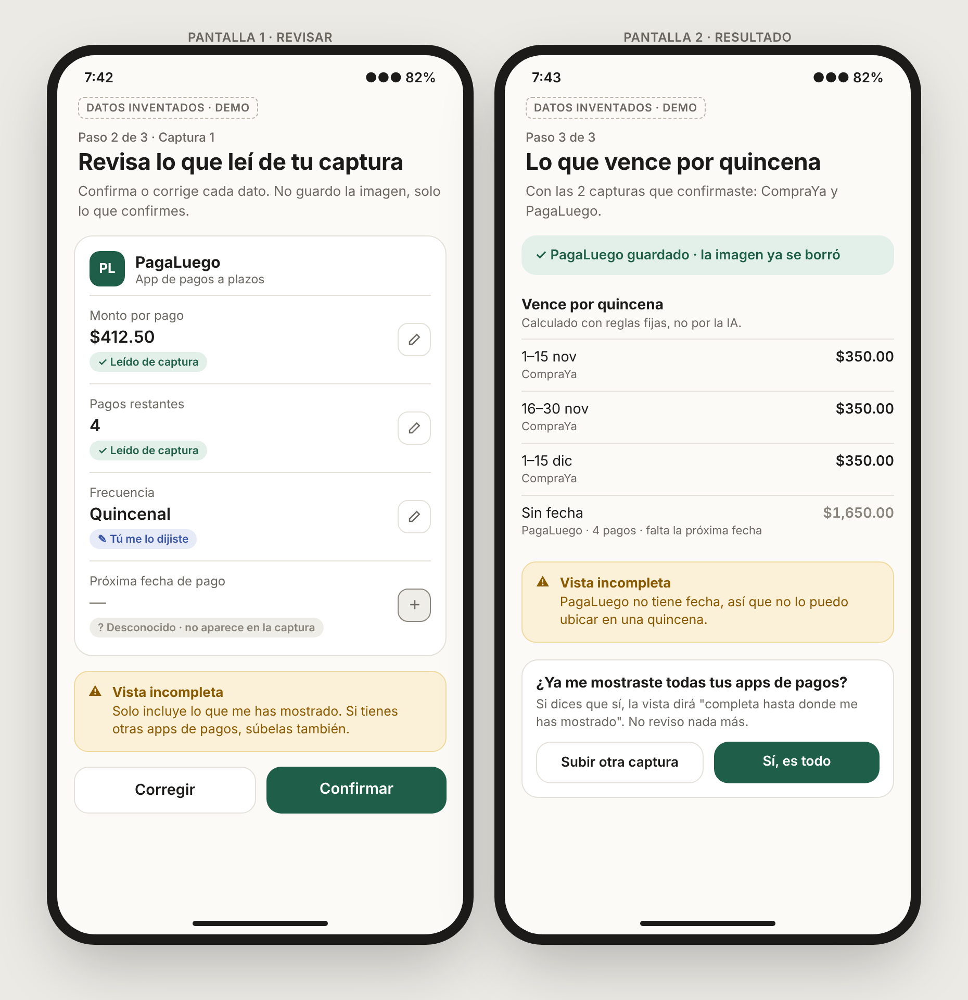
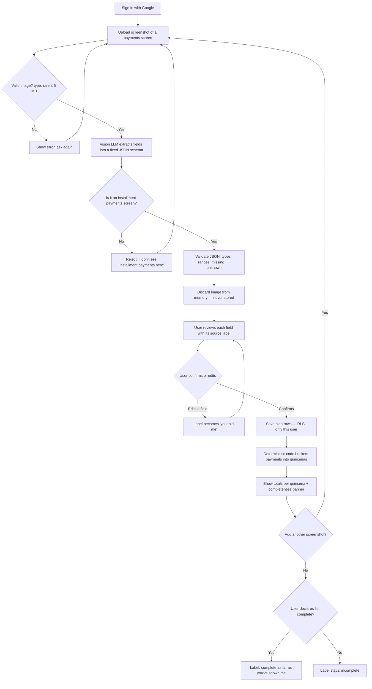
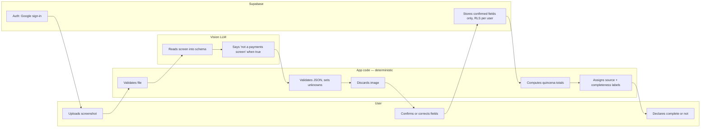

# PACKET — Week 10 · Fátima · Screenshot-to-Ledger

> Slice of the team Blueprint (Week 10, Isle of Happiness): **DEBT GUARDRAILS** — my declaration is *screenshot extraction with confirmed fields and unknown/incomplete labels* (Conditions C1/C2).
> Draft v2 — memory test data added; installment amounts still to be verified against the apps.

---

## 1. Problem (in my words)

People in Mexico stack installment plans across several apps (Kueski, Aplazo, Mercado Pago…) and no screen shows them together. When they decide on a new purchase, they rely on memory for what they already owe — and memory is wrong in two ways: it forgets whole apps (completeness) and it misremembers amounts and dates (accuracy). The apps themselves already show the truth, one app at a time, on a payments screen. My slice turns those screenshots into one confirmed, source-labeled list of commitments per quincena — without bank access, without guessing, and without ever pretending the list is complete when it isn't.

**Evidence so far (n = 1, anecdotal):** memory-vs-reality test with one friend (23, intern).

*Installment plans — from memory only (not yet checked against the apps):*

| Provider | What he remembered | Monthly equivalent |
|---|---|---|
| Amazon (months) | ~MX$500/month, ~3 left | MX$500 |
| Mercado Pago | ~MX$400/quincena, 2–3 left | MX$800 |
| Aplazo | ~MX$600/quincena, ~2 left | MX$1,200 |
| Kueski | "not sure if I finished paying" | unknown |
| Credit card (meses sin intereses) | "don't know if it counts" | unknown |
| **His own itemized sum** | | **MX$2,500/month + unknowns** |
| **His overall estimate** | "about MX$1,500/month" | **MX$1,500/month** |

→ His estimate is exactly 500 + 400 + 600 = **MX$1,500: he added one payment from each app and called it a month**, but two of the three are paid *per quincena*. Correctly converted, his own memory says MX$2,500/month — his estimate is **40% low**, before checking any app. The error isn't forgetting; it's **mixing payment frequencies**. Two providers are also *unknown* in his own words, and he doesn't open the apps: "I pay when the notification arrives."

**Design consequence:** frequency is a required field, and the monthly/quincena conversion is done by code, never by the user or the LLM (C2).

*Subscriptions (recurring, not installments) — memory vs. checking:*
- From memory: 3 services (Spotify, Netflix, gym) = MX$1,079/month.
- After checking: 6 services = MX$1,511/month → **3 of 6 forgotten (50%)**, total **29% under**.
- Caveat: he checked using an AI assistant connected to his phone. The resulting table matches published Mexican list prices and the gym is still an estimate, so treat it as "checked with an assistant," not as his confirmed charges.

**What this tells me:** both failure modes show up — whole services forgotten (completeness) and amounts that don't add up (accuracy). It also exposes two scope questions: credit-card *meses sin intereses* and subscriptions are commitments he forgets the same way, but they live outside installment apps.

**Still missing:** opening Amazon, Mercado Pago, Aplazo and Kueski and recording the real amounts — the actual test of my slice.

## 2. Exact user

A 23-year-old intern in Mexico earning roughly MX$8,000–15,000 a month, with 3–4 installment providers open (Amazon, Mercado Pago, Aplazo, maybe Kueski) plus card purchases a meses. By his own itemized memory, installments take MX$2,500/month — **17–31% of his income** — but he believes it's MX$1,500 because he adds quincenal and monthly payments as if they were the same. He never opens the apps; he pays when the notification arrives. Uses his phone all day and screenshots easily. Not organized enough to keep a spreadsheet; organized enough to take a screenshot when asked.

**Design consequence:** the flow must ask him to open apps he avoids. Every extra step is a place he quits.

**Not my user (this week):** people using unregistered loan apps, people whose purchases go on someone else's card, tienditas.

## 3. Success definition

**Before the module closes:** a signed-in user uploads a screenshot of an (invented) installment-app payments screen, confirms or corrects every extracted field, and sees what is due per quincena — every amount labeled by source, and the view marked *incomplete* unless the user declares it complete.

Measured on my synthetic test set:
- ≥ 95% of extracted fields correct.
- **0** invented values: any field not visible in the image comes back as `unknown`, never as a guess.
- Non-payment screenshots are rejected, not "extracted."

## 4. Mockup

`docs/mockup_pantallas.png` — rendered from `docs/mockup_pantallas.html` (HTML mockup of two phone screens: review and result, built with the LLM and screenshotted). It shows the three field labels, an unknown date that blocks the plan from being placed in a quincena, the incomplete-view banner, and quincena totals computed by fixed rules. All data invented.

Prompt for an image-model version, if required:

> Mobile app screen, clean minimal fintech UI, Spanish text, white background, one accent color. Title "Revisa lo que leí de tu captura". A card for a fictional app "PagaLuego" showing editable fields with small colored source tags: "Monto por pago: $412.50 ✓ leído de captura", "Pagos restantes: 4 ✓ leído de captura", "Próxima fecha: — desconocido (no aparece en la captura)" in grey with an edit pencil. Below, a yellow banner: "Vista incompleta: solo incluye lo que me has mostrado." Two buttons: "Confirmar" and "Corregir". Bottom: small table "Vence por quincena" with three rows. No real bank or brand logos.

## 5. Flow

### 5a. Flowchart

### 5b. Swimlane — who does what

The LLM never does arithmetic and never decides affordability (C2). Totals come from code.

## 6. Benchmark line

**The best existing solution on Earth for this is** Finny's *Screen Log* (US): it reads a Klarna/Afterpay/Affirm payment from the screen, stages it for review, and imports nothing until the user confirms — no bank or BNPL account connection. *(Source: Finny's own blog; I could not verify independently or confirm whether it works in Mexico.)*

**Mine differs or localizes by** labeling every amount by source and the whole view by completeness, discarding the screenshot instead of saving it as a photo, and bucketing by Mexican quincenas across Mexican installment apps.

## 7. Long view (3 years)

If this slice works, it becomes the intake layer of a buyer-owned commitment calendar that cajas de ahorro or public programs offer their members — the user's own screenshots and free bureau reports feeding one honest view of what they owe. It never becomes a lender, a store, or a score sold to anyone. The load-bearing walls I'm choosing now — confirmation before saving, source labels, no stored images, no seller money — are the ones that keep it on the buyer's side when someone offers to fund it.

## 8. Scope cut — what I am NOT building

- Six-quincena calendar UI and user-set limits → **Rafael's slice**; I output data he can consume.
- Purchase pause → Operator. Tiendita replenishment → Rodrigo. Fit comparison → Nicolás.
- Credit-card *meses sin intereses* (card statements are a different screen; the results view says "card installments not included").
- Subscriptions (recorded as a finding from the memory test, not built).
- Bank sync, email parsing, notification reading, WhatsApp bot.
- Bureau report parsing (Buró/Círculo PDFs).
- Price comparison, SIPRES check, any recommendation.
- Interest-rate or "can you afford it" claims.
- Storing screenshots.

## 9. Architecture + stack (free tier only)

| Layer | Choice | Why | Risk / note |
|---|---|---|---|
| Frontend + API routes | Next.js on Vercel (free) | One repo, server-side API key | Keys in Vercel env vars only |
| Auth | Supabase Auth, Google sign-in | Personal data → auth required | — |
| Database | Supabase Postgres, RLS on | User sees only own rows | Test with a 2nd account |
| Vision extraction | Gemini API, free tier | Free image input | **Free-tier content may be used to improve Google products** → demo uses invented screenshots only; real users would require a paid, no-training tier |
| Arithmetic | Plain TypeScript functions | C2: rules calculate, LLM explains | Unit-tested |
| Image handling | In-memory only | Minimum retention (C4) | Verify no storage bucket exists |

**Data model**

- `payment_plans`: `id, user_id, provider_name, installment_amount, payments_remaining, next_due_date, frequency, field_sources (json: per field 'screenshot' | 'user' | 'unknown'), captured_at, confirmed_at`
- `ledger_status`: `user_id, completeness ('incomplete' | 'complete_as_shown' | 'incomplete_by_choice'), updated_at`

**Labels shown on screen:** *leído de captura* · *tú me lo dijiste* · *desconocido* — and for the whole view: *incompleta* · *completa hasta donde me has mostrado* · *incompleta por tu decisión*.

**Simulated outputs:** if the API is unavailable, a canned extraction can be shown for demo — always with a visible "SIMULADO" tag.

## 10. Security floor

| Check | How |
|---|---|
| No secrets in repo | Gemini + Supabase keys in Vercel env vars; `.env*` in `.gitignore` |
| Auth on personal data | Supabase Google sign-in before any upload |
| RLS on | Policies on both tables: `user_id = auth.uid()` |
| Input validation | File type (png/jpg), size ≤ 5 MB; JSON schema validation; amounts 0–100,000; payments 0–60; dates within ±2 years; text fields ≤ 60 chars |
| No real personal data | Invented app "PagaLuego" and invented screenshots only; real friend's screenshots never leave his phone |

## 11. Test plan

**Synthetic set (invented screenshots, ground truth known):**

| # | Case | Expected |
|---|---|---|
| 1–3 | Clean payments screens, one plan each | All fields correct |
| 4 | Two plans on one screen | Two plans extracted |
| 5 | Cropped — no due date visible | Date = `unknown`, not guessed |
| 6 | Blurry / low resolution | Unreadable fields = `unknown` |
| 7 | Not a payments screen (e.g., chat screenshot) | Rejected |
| 8 | Amount with cents and thousands separator ($1,412.50) | Parsed exactly |

**Mechanical tests:**
- Quincena bucketing: due on the 15th vs. 16th; February month-end; monthly vs. biweekly frequency.
- Editing a field flips its label to *tú me lo dijiste*.
- Completeness banner shows *incompleta* by default.
- RLS: second Google account cannot read first account's plans.
- Validation: reject a 10 MB file, a PDF, a negative amount.
- No image persisted (check Supabase storage and DB).

**Persona test:** later, in a new conversation, per course rules.
